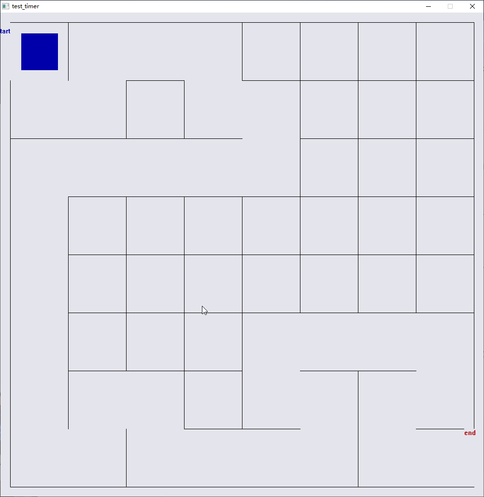

# -迷宫地图游戏（C语言）

地图生成算法  DFS深度路径搜索/回溯算法

```
伪代码如下
* 定义一个宽 W，高 H 的二维数组。全部填充为“墙”。
* 选一个起点 (x, y)，标记为“路”。
* 将起点压入栈 (Stack)。
* while (栈不为空) {
  从栈顶取出当前点。
  寻找当前点上下左右距离为 2 的未访问邻居。
  if (有未访问邻居) {
  随机选一个邻居。
  打通当前点和邻居中间的墙。
  将邻居标记为“路”，压入栈。
  } else {
  当前点出栈（回溯）。
  }
  }
* 最后，在四周的墙上开两个洞作为起点和终点。
```

- 重复伪代码（伪代码描述）

1. 定义一个宽 W，高 H 的二维数组。全部填充为“墙”。
2. 选一个起点 (x, y)，标记为“路”。
3. 将起点压入栈 (Stack)。
4. while (栈不为空) {
   从栈顶取出当前点。
   寻找当前点上下左右距离为 2 的未访问邻居。
   if (有未访问邻居) {
   随机选一个邻居。
   打通当前点和邻居中间的墙。
   将邻居标记为“路”，压入栈。
   } else {
   当前点出栈（回溯）。
   }
   }
5. 最后，在四周的墙上开两个洞作为起点和终点。

```

```

其余用到的框架是easyX，导入头文件是<graphics.h>


游戏截图如下：



![迷宫演示图]

(https://raw.githubusercontent.com/ldcr332/-/dff3bd6ac67f5d5050870b0edbb85dcb364fd3c9/img/demo.png)
